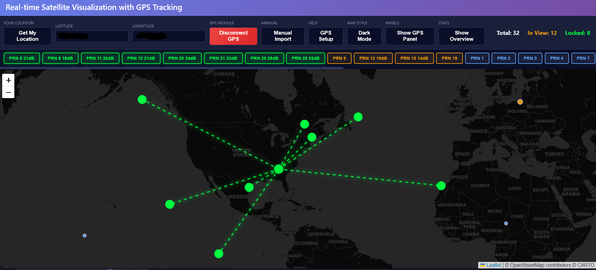

`Web` [`JavaScript`](https://developer.mozilla.org/en-US/docs/Web/JavaScript) `GPS` `Visualization` - Real-time GPS satellite tracker - Educational visualization tool

[Project website / live view](https://ringmast4r.github.io/GNSS/)

 

---

# GPS Satellite Tracker

A real-time visualization tool to see which GPS satellites you're actually connecting to when using GPS modules.

🌐 **[Live Demo](https://ringmast4r.github.io/GNSS/)**

## `> why_this_exists`

I wanted to create an educational tool to visualize which satellites my GPS modules connect with - which ones are overhead, their signal strength, and which are actively being used for positioning. This makes the invisible world of GPS visible and helps understand how GPS positioning actually works.

## `> features`

- **Real-time satellite tracking** - See all 32 GPS satellites moving overhead
- **Live GPS module connection** - Connect your GPS receiver via USB to see real signal data
- **Signal strength visualization** - SNR bars for each satellite
- **Color-coded status**:
  - Gray: Below horizon
  - Blue: Above horizon (visible)
  - Orange: Detected by your GPS module
  - Green: Actively used for position fix

## `> quick_start`

1. Open `index.html` in Chrome or Edge
2. Click "Get My Location" or enter coordinates
3. (Optional) Connect GPS module via "Connect GPS Module" button
4. Watch satellites move in real-time

## `> supported_gps_modules`

Any NMEA-compatible GPS module:
- u-blox (NEO-6M, NEO-7M, NEO-8M, NEO-M9N)
- Adafruit GPS modules
- GlobalSat BU-353
- Generic USB GPS receivers

## `> browser_requirements`

Chrome 89+, Edge 89+, or Opera 75+ (Web Serial API required for GPS module connection)

## `> credits`

Built with Satellite.js, Leaflet, and TLE data from Celestrak

## `> license`

CC BY 4.0 (Creative Commons Attribution 4.0 International) - Free to use with **attribution to Ringmast4r required**. See [LICENSE](LICENSE) file for details.

---

