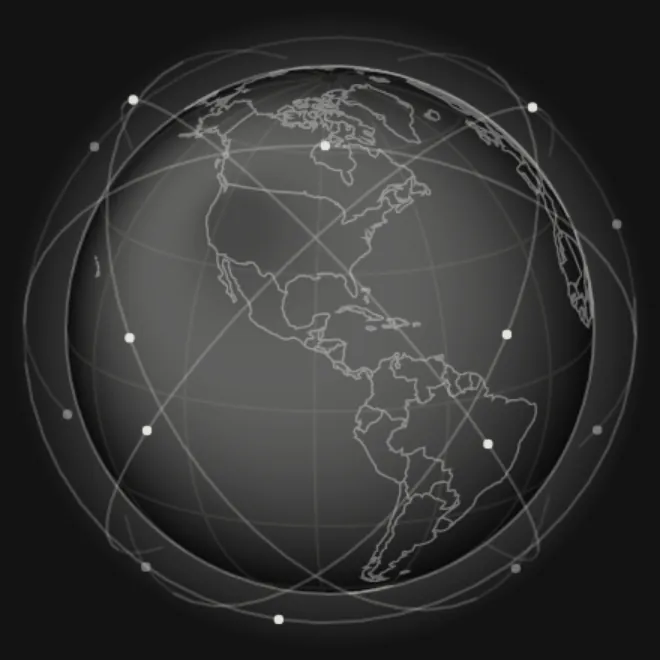
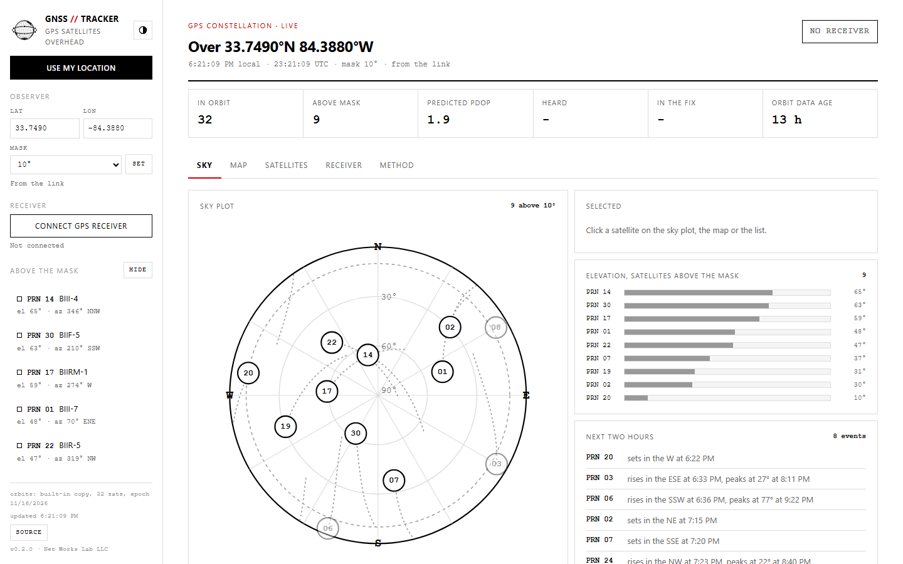
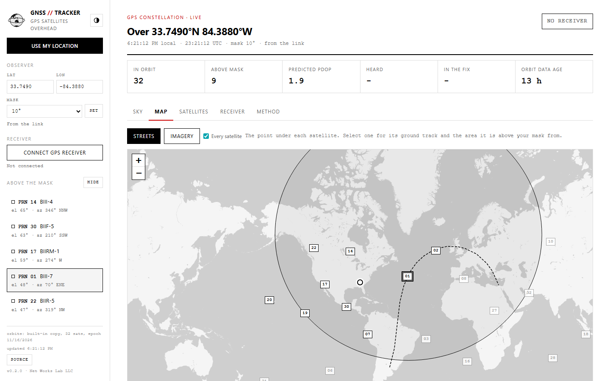
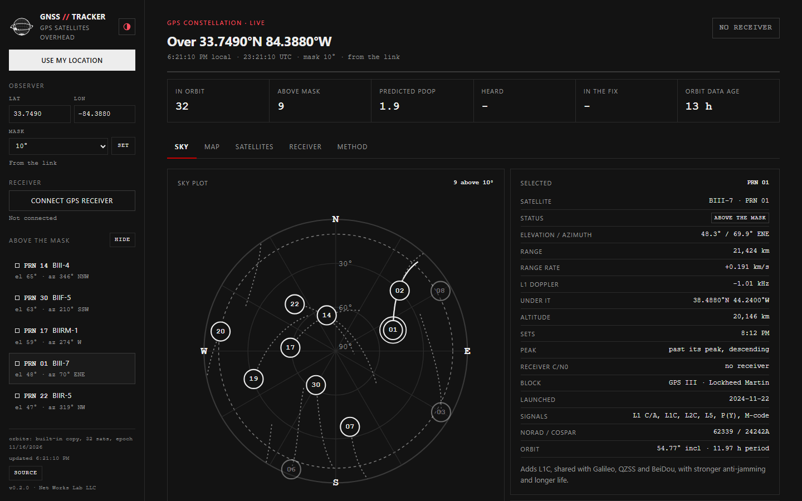
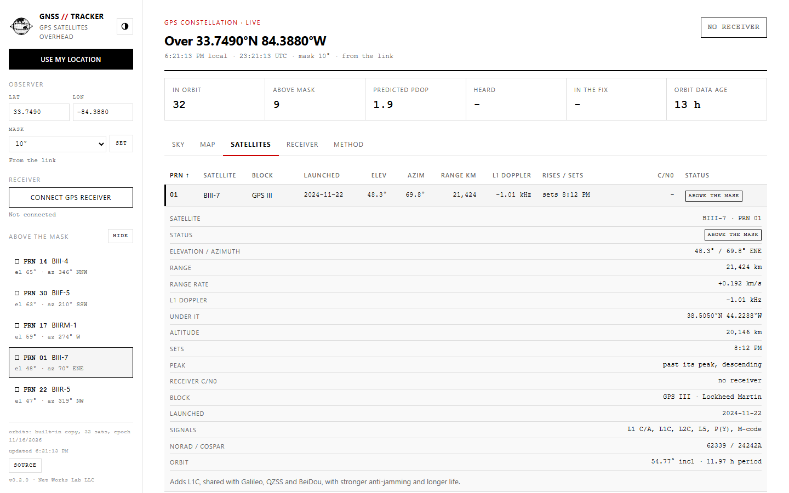

<div align="center">


`Web` [`JavaScript`](https://developer.mozilla.org/en-US/docs/Web/JavaScript) [`satellite.js`](https://github.com/shashwatak/satellite-js) [`Leaflet`](https://leafletjs.com) [`Web Serial`](https://developer.mozilla.org/en-US/docs/Web/API/Web_Serial_API) `NMEA 0183` `GPS` `GNSS` - Which GPS satellites are over you right now, where they are going, and which ones your receiver is really using - live at [ringmast4r.github.io/GNSS](https://ringmast4r.github.io/GNSS/)

[Open the live tracker](https://ringmast4r.github.io/GNSS/)

[](https://git.io/typing-svg)



<br>

[](https://github.com/Ringmast4r/GNSS)
[](https://github.com/Ringmast4r/GNSS/releases)
[](https://ringmast4r.github.io/GNSS/)
[](LICENSE)

[](https://github.com/Ringmast4r/GNSS/stargazers)
[](https://github.com/Ringmast4r/GNSS/network/members)
[](https://github.com/Ringmast4r/GNSS)
[](https://github.com/Ringmast4r/GNSS/commits/main)

</div>

---



<a id="what-it-shows"></a>
## `> what_it_shows`

- **Sky plot.** North up, the horizon at the edge, overhead in the centre. Every GPS satellite above the horizon, faded below your elevation mask, with its track for the next two hours. Click one for everything known about it: range, range rate, L1 Doppler, the point under it, block, launch, signals and orbit.
- **Map.** The point on the ground under each satellite. Select one for its ground track (three hours either side) and the area from which it stands above your mask.
- **Satellites.** Every operational satellite in one sortable table: block, launch, elevation, azimuth, range, L1 Doppler, next rise or set, and the receiver's C/N0.
- **Predicted DOP.** The position dilution of precision the current geometry gives a receiver at your position.
- **Next two hours.** Every rise and set across your mask, with the compass direction and the peak.
- **Receiver.** Plug in a USB GPS or GNSS receiver and see what it actually hears: every constellation (GPS, GLONASS, Galileo, BeiDou, QZSS, NavIC, SBAS), C/N0 per satellite, the satellites in its fix, fix type and quality, PDOP / HDOP / VDOP, position, time and speed, and the raw NMEA. Satellites it hears turn grey on the sky plot; the ones in its fix turn solid.
- **Replay.** Load a saved NMEA log or paste sentences to read a receiver you are not plugged into. Bad checksums are counted and shown in red.



<a id="use-it"></a>
## `> use_it`

1. Open the [live tracker](https://ringmast4r.github.io/GNSS/) in Chrome or Edge. The map and sky plot work in any modern browser; serial ports need Chrome, Edge or Opera on a computer.
2. Press **Use my location**, or type a latitude and longitude and press **Set**. A link can carry a position: `?lat=33.749&lon=-84.388`.
3. Pick an elevation mask (10 degrees is the usual cut-off for a clear view).
4. Optional: press **Connect GPS receiver**, pick the port (COM3, USB-Serial, CH340, u-blox) and leave the speed on **Find it**. The tracker listens at each common baud rate until it hears clean NMEA.

Receivers that work: any NMEA 0183 receiver, for example u-blox NEO-6M, 7M, 8M and M9N, Adafruit Ultimate GPS, GlobalSat BU-353, or a module behind a USB-serial adapter. A cold start takes 30 to 60 seconds before the first fix and needs a view of the sky.

Nothing is sent anywhere. Your position, the receiver's data and the log stay in your browser; the position, mask and theme are remembered there only.

<a id="screens"></a>
## `> screens`

| Dark | Every satellite |
|---|---|
|  |  |

<a id="how-it-works"></a>
## `> how_it_works`

| Piece | What it does |
|---|---|
| `js/orbits.js` | Parses the TLEs, runs SGP4 ([satellite.js](https://github.com/shashwatak/satellite-js)) for azimuth, elevation, range and the sub-satellite point; range rate and L1 Doppler by a one-second difference; rise, peak and set over the next 12 hours (one-minute steps, crossings narrowed to the second); sky tracks; DOP from the geometry; the coverage radius on the ground. |
| `js/nmea.js` | NMEA 0183 with checksum checks: GSV (in view, C/N0), GSA (in the fix, DOP, NMEA 4.1 system id), GGA (fix, quality, altitude), RMC (position, time, speed), every talker. Web Serial with baud detection. |
| `js/app.js` | The page: one tick a second, the open tab only, passes once a minute. |
| `css/style.css` | The Net Works house UI: black and white, red for errors only, light and dark, the spinning Net Works globe top left. |
| `data/gps-ops.txt` | CelesTrak's `gps-ops` TLEs. `scripts/refresh_orbits.py` pulls a fresh copy (CelesTrak asks for no more than one pull of a group every two hours). The age of the set shows in the stats and turns red after 14 days. |

Run the checks (headless Chromium, from disk, 169 checks including orbit sanity and an NMEA replay):

```
py -3.13 tests/check_page.py
```

<a id="credits"></a>
## `> credits`

Orbits: [CelesTrak](https://celestrak.org). Propagation: [satellite.js](https://github.com/shashwatak/satellite-js) (MIT). Map: [Leaflet](https://leafletjs.com) (BSD-2), &copy; OpenStreetMap contributors, Esri World Imagery. Built by Ringmast4r, Net Works Lab LLC.

<a id="license"></a>
## `> license`

CC BY 4.0 (Creative Commons Attribution 4.0 International). Free to use with **attribution to Ringmast4r required**. See [LICENSE](LICENSE).

---

<div align="center">


</div>
